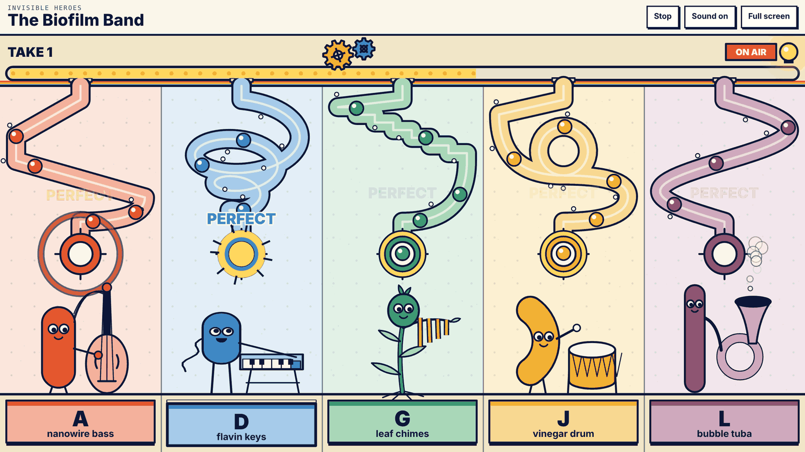
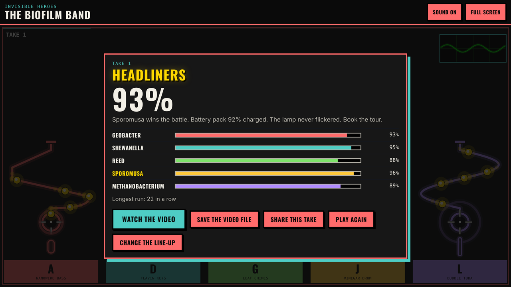
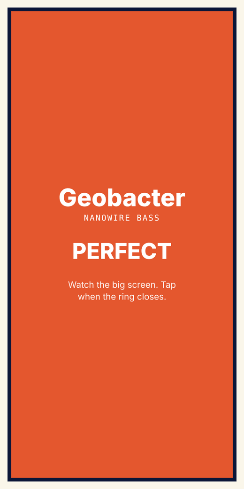
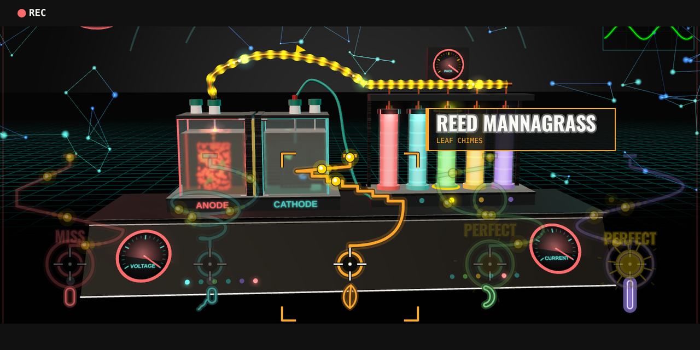
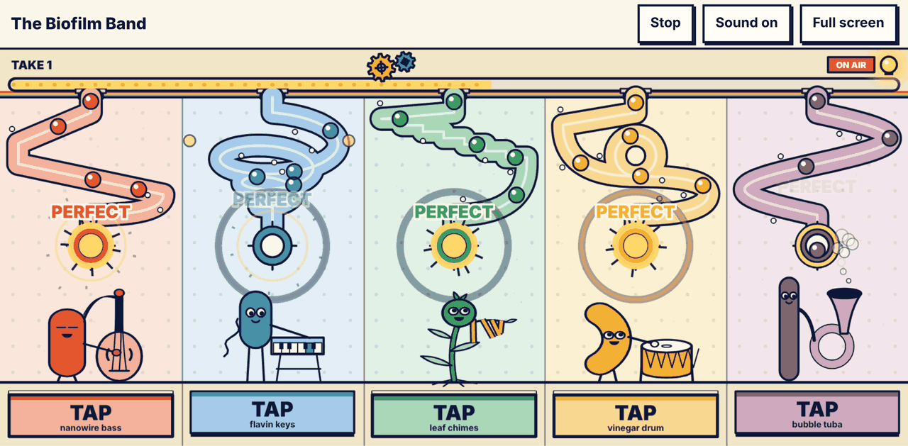
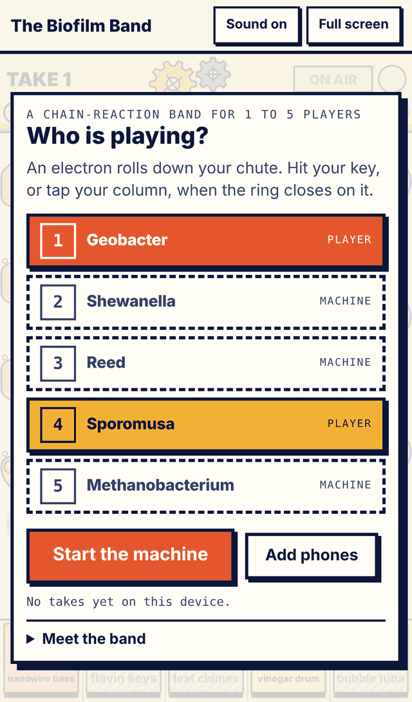

# Invisible Heroes: The Biofilm Band

**▶ Play it now: [invisibleheroes.vercel.app](https://invisibleheroes.vercel.app/)**

A music game for one to five players around one screen, about a minute a
take. Play with keys, with fingers, or scan a QR code and use your phone as
your button.

It is a band battle. Each player is a microbe (or a plant) with an
instrument. Electrons run down five lanes, one per player; hit your key when
an electron reaches your ring and it goes through a fuel cell into your cell
of a five-cell battery. The fullest cell wins the take, and the whole pack is
the band's score. When the song ends the game cuts the take into a music video
you can watch, save as a file and send to someone as a link.

The stage is two layers: a 3D microbial fuel cell and its battery (three.js,
fetched after the page is up), and over it the note lanes. Adding
`?scene=off` to the address plays without the 3D layer on a slow device.



## How it works

Open [invisibleheroes.vercel.app](https://invisibleheroes.vercel.app/) on any
screen. Nothing to install, no account.

| 1. Pick the band | 2. Play the take | 3. Get the video |
| :---: | :---: | :---: |
|  |  |  |
| Tap a hero to play it; the machine plays the rest. | Hit your key as each electron reaches your ring. | See the score, watch the cut video, save it or share a link. |

Want friends in on it? Press **Add phones** on the big screen, scan the QR
code, and each phone becomes one player's button (see
[Play with phones](#play-with-phones)).

## How to play

1. **Pick who plays.** Tap a hero to make it a player; the rest are played by
   the machine, so the song is always complete. One player is fine.
2. **Start the machine.** Four counts, then the drum comes in alone, then the
   bass, then the keys, then everyone. You hear your own entrance.
3. **Catch your electrons.** A ring closes on your target as each electron
   arrives. Press when the ring meets it.
4. **Watch the video.** The results card shows how each player did. "Watch the
   video" replays the take with camera cuts; "Save the video file" records it
   as you watch; "Share this take" makes a link that plays your video on
   someone else's screen and dares them to beat it.

| Seat | Hero                                       | Instrument      | Job in the fuel cell                         | Key | Touch         |
| ---- | ------------------------------------------ | --------------- | -------------------------------------------- | --- | ------------- |
| 1    | Geo (_Geobacter sulfurreducens_)           | nanowire bass   | gives electrons straight to the anode        | `A` | first column  |
| 2    | Shiva (_Shewanella oneidensis_)            | flavin keys     | gives electrons by shuttle, half a beat late | `D` | second column |
| 3    | Rhodo (_Rhodopseudomonas palustris_)       | sunlight chimes | gives electrons from sunlight                | `G` | third column  |
| 4    | Sporo (_Sporomusa ovata_)                  | vinegar drum    | takes electrons at the cathode               | `J` | fourth column |
| 5    | Cable (cable bacteria, Desulfobulbaceae)   | cable tuba      | carries the current                          | `L` | fifth column  |

Keys `1` to `5` work too. Alone, the space bar is your key. `Esc` stops a take.
On a phone or tablet every column is a touch pad from top to bottom, and every
finger counts on its own, so five people can play one screen. With three or
more on one phone, turn it sideways.

A press within 0.07 s of the beat is a PERFECT, within 0.16 s a GOOD. The team
score counts a PERFECT as 1 and a GOOD as 0.7, over the players' seats only.

### The band is a fuel cell

Every note you land feeds a small model of a microbial fuel cell
(`src/kinetics.ts`), and the cell is what lights the lamp, swings the VOLTAGE
and CURRENT dials, grows the biofilm and opens up the sound of the band:

- **Geo, Shiva and Rhodo give.** Each landed note puts electrons on the anode.
  Geo's arrive at once down its nanowires; Shiva's ride a flavin shuttle and
  land half a beat later, on the beat its keys skank against; Rhodo's scale
  with the sunlight, which rises from dawn in the intro to full sun in the
  chorus. Their biofilm grows as they land notes and thins with every miss, and
  a thicker biofilm gives more per note.
- **Sporo takes.** The drum is the cathode: every landed beat lets electrons
  off the anode to make acetate. Without the drum, no current flows at all.
- **Cable carries.** Every landed tuba note lowers the cell's resistance, which
  creeps back up between notes. Without the cable the cell makes about a third
  less.

Power is voltage times current, and the voltage sags as the current climbs, as
in a real cell. The results card says how much energy the take made against a
perfect band, and which player's part held the cell back the most.

### The city runs on the battery

Behind the stage is a city, after the one in MESSAI's lab simulator
(`/lab/city`): flat blocks, blocks with a rooftop unit and slender towers,
seeded so everyone sees the same skyline. Its light follows the battery. A flat
pack, or a band that has stopped landing notes, leaves it a dark night with a
few windows lit; as the pack charges and the band finds its groove, the sky
pales through dusk amber to a daylight haze, the buildings turn from
silhouettes to stone and more windows come on.

The level is `0.6 x` the pack's mean charge `+ 0.4 x` the groove, eased over
about a second so the city breathes with the band and not with each beat
(`batteryLevel` and `smoothLevel` in `src/three/daylight.ts`). The charge only
ever climbs through a take, so the groove is what lets the city dim again when
the band falters. A replay of a take lights the city the same way, so the saved
video shows it too.

### Play with phones

Put the game on a big screen and press **Add phones**. A QR code appears.
Each phone that scans it joins the room, is given the next free hero, and
becomes that player's button: a single pad the size of the screen. Everyone
watches the big screen, which makes all the sound, and taps their own phone.
A phone can pick a different free hero in the lobby; tapping a phone's seat on
the big screen hands it back to the machine. Keys, fingers on the big screen
and phones can be mixed in one band.


<p>
  
  
</p>

The phones have to be able to open the page, so the game must be served from
an address they can reach: a deployed copy, or `npm run dev -- --host` on the
same wifi (then open the big screen at the computer's network address, not
`localhost`, so the QR code carries that address).

|                                                        |                                                                          |
| ------------------------------------------------------ | ------------------------------------------------------------------------ |
|     |                         |
|  |  |

<p>
  
  
</p>

## The heroes are real

The instruments are made up. What each hero does is not:

- **_Geobacter sulfurreducens_** grows protein filaments that conduct
  electricity and passes electrons along them to an electrode (Reguera et al.,
  Nature 2005).
- **_Shewanella oneidensis_** releases flavins, small molecules that carry its
  electrons across to a surface (Marsili et al., PNAS 2008).
- **_Rhodopseudomonas palustris_** is a purple bacterium that runs on sunlight,
  makes hydrogen, and can make electricity in a fuel cell (Xing et al.,
  Environ. Sci. Technol. 2008).
- **_Sporomusa ovata_** takes electrons from an electrode and uses them to turn
  carbon dioxide into acetate, the acid in vinegar (Nevin et al., mBio 2010).
- **Cable bacteria** join thousands of cells end to end into living wires that
  carry electrons centimetres through seafloor mud (Pfeffer et al., Nature
  2012).

So the band lines up like a circuit: three that give electrons, one that
carries them, and one that takes them back. The microbe pictures in
`public/microbes/` and the learning cards in `src/microbes.ts` are by Anaïs.

## Run it

```bash
npm install
npm run dev       # play at http://localhost:5173
npm test          # unit tests
npm run build     # static site in dist/, works from any path
```

No audio files, and the only pictures are the heroes' portraits: the sound is synthesised with the Web Audio API and
the picture is drawn on one canvas. Two small libraries are bundled, PeerJS
for the phone connection and a QR code generator; the first is only fetched
when a room is opened.

## How it is built

| File              | What it holds                                                                 |
| ----------------- | ----------------------------------------------------------------------------- |
| `src/score.ts`    | The tune as data: 24 bars, five parts, step patterns over an Am, F, C, G loop |
| `src/engine.ts`   | One run through the tune: grades presses, plays the machine's seats, scores   |
| `src/kinetics.ts` | The fuel cell: biofilm, shuttles, sunlight, cathode, resistance, power        |
| `src/microbes.ts` | The five heroes' learning cards and pictures                                  |
| `src/take.ts`     | A finished take as about 140 characters, so it fits in a link                 |
| `src/director.ts` | The video's shot list, decided from the take alone                            |
| `src/game.ts`     | The conductor: the clock, the animation loop, sound scheduled ahead           |
| `src/render.ts`   | The canvas: machine, heroes, camera. Draws from one frame of plain data       |
| `src/three/daylight.ts` | The battery's level and the city's palette at that level (pure)          |
| `src/three/city-layout.ts`, `src/three/city.ts` | Where the buildings stand (pure), and the instanced city  |
| `src/synth.ts`    | Five synthesised instruments and the machine's clicks                         |
| `src/recorder.ts` | Captures the canvas and the mix into a video file                             |
| `src/storage.ts`  | Takes played, best score and days in a row, kept on the device                |
| `src/shell.ts`    | The big screen's page: line-up, room, results, keys and fingers               |
| `src/controller.ts` | The phone's page: pick a hero, then one pad                                 |
| `src/net/`        | Room codes, messages, clock sync, seats, and the carriers that move them      |
| `src/main.ts`     | The front door: a join link opens the phone page, anything else the game      |

### Multiplayer

The engine does not know where a press came from: `press(run, seat, time)` is
the whole input surface, and the renderer draws from the tune, the grades and
the time alone. Keys, fingers, a mouse and a phone all go through that one
call.

A phone connects to the big screen over a WebRTC data channel (PeerJS; its
public broker only introduces the devices, and is loaded only when a room is
opened). Two things keep a phone player on the beat despite the network:

- **The press carries its own time.** The phone measures the big screen's
  clock with ping round trips, trusting the fastest of the last eight, and
  stamps each tap with the big screen's time at the moment the finger went
  down. The game judges the tap at that time, not when it arrived.
- **A phone's notes wait.** A seat played from a phone holds its notes 0.3 s
  longer before they become misses, so a tap that is still in flight has a
  note to land on. The timing windows themselves are not widened.

Everything that arrives from a phone is validated before use
(`src/net/protocol.ts`).

When the venue wifi keeps phones from reaching the big screen directly
(common on event, school and hotel networks), phones fall back by themselves
to a relay through Supabase Realtime Broadcast; presses still land on the beat
because each one carries the time it was made. To turn the relay on, set
`VITE_SUPABASE_URL` and `VITE_SUPABASE_ANON_KEY` (the publishable key, never
the service-role key) in `.env`, or in the host's environment settings; leave
either one empty and the game uses direct connections only. One five-phone
take costs about 2,500 relay messages, so the free plan's 2 million a month
is roughly 800 takes. The relay's topics are public: anyone holding the key
and a room's four-letter code could listen in or press for a player.

### Performance

The stage is one canvas. Scenery that does not move is drawn once per resize
and copied each frame; the frame loop allocates nothing; the device pixel
ratio is capped at 2; sound is handed to the audio clock 120 ms ahead so a
slow frame cannot make the band late.
