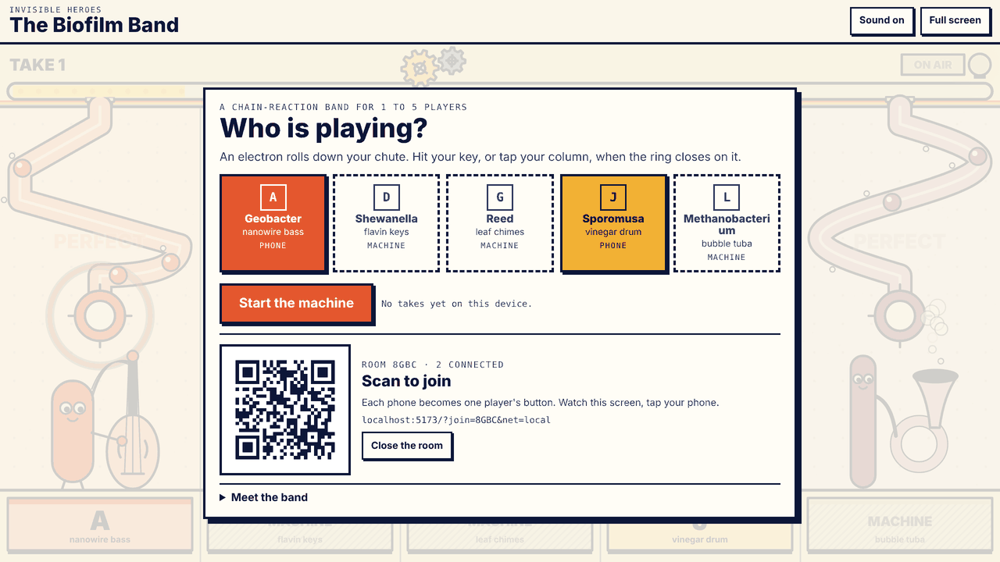
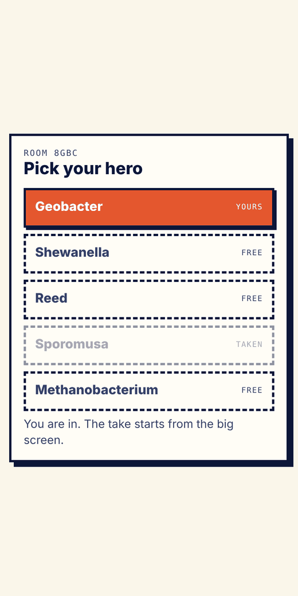
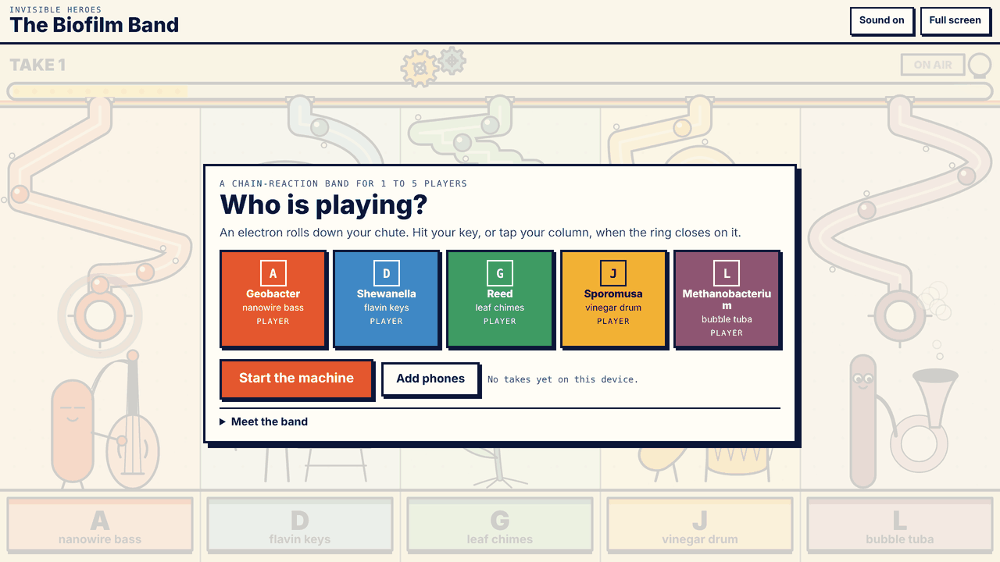
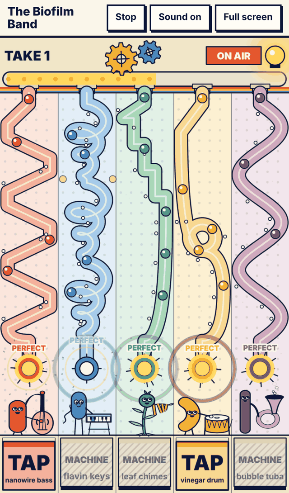

# Invisible Heroes: The Biofilm Band

A music game for one to five players around one screen, about a minute a
take. Play with keys, with fingers, or scan a QR code and use your phone as
your button.

Each player is a microbe (or a plant) with an instrument. Electrons roll down a
chain-reaction machine, one chute per player. Hit your key when the electron
reaches your ring and your hero plays its note. Land enough of them together
and the lamp lights up. When the song ends the game cuts your take into a
music video you can watch, save as a file and send to someone as a link.


## How to play

1. **Pick who plays.** Tap a hero to make it a player; the rest are played by
   the machine, so the song is always complete. One player is fine.
2. **Start the machine.** Four counts, then the drum comes in alone, then the
   bass, then the keys, then everyone. You hear your own entrance.
3. **Catch your electrons.** A ring closes on your target as each electron
   arrives. Press when the ring meets it.
4. **Watch the video.** The results card shows how each player did. "Watch the
   video" replays the take with camera cuts; "Save the video file" records it
   as you watch; "Share this take" makes a link that plays your video on
   someone else's screen and dares them to beat it.

| Seat | Hero                                | Instrument    | Key | Touch         |
| ---- | ----------------------------------- | ------------- | --- | ------------- |
| 1    | _Geobacter sulfurreducens_          | nanowire bass | `A` | first column  |
| 2    | _Shewanella oneidensis_             | flavin keys   | `D` | second column |
| 3    | Reed mannagrass (_Glyceria maxima_) | leaf chimes   | `G` | third column  |
| 4    | _Sporomusa ovata_                   | vinegar drum  | `J` | fourth column |
| 5    | _Methanobacterium palustre_         | bubble tuba   | `L` | fifth column  |

Keys `1` to `5` work too. Alone, the space bar is your key. `Esc` stops a take.
On a phone or tablet every column is a touch pad from top to bottom, and every
finger counts on its own, so five people can play one screen. With three or
more on one phone, turn it sideways.

A press within 0.07 s of the beat is a PERFECT, within 0.16 s a GOOD. The team
score counts a PERFECT as 1 and a GOOD as 0.7, over the players' seats only.

### Play with phones

Put the game on a big screen and press **Add phones**. A QR code appears.
Each phone that scans it joins the room, is given the next free hero, and
becomes that player's button: a single pad the size of the screen. Everyone
watches the big screen, which makes all the sound, and taps their own phone.
A phone can pick a different free hero in the lobby; tapping a phone's seat on
the big screen hands it back to the machine. Keys, fingers on the big screen
and phones can be mixed in one band.



<p>
  
  
</p>

The phones have to be able to open the page, so the game must be served from
an address they can reach: a deployed copy, or `npm run dev -- --host` on the
same wifi (then open the big screen at the computer's network address, not
`localhost`, so the QR code carries that address).

|                                                        |                                                                          |
| ------------------------------------------------------ | ------------------------------------------------------------------------ |
|     |                         |
|  |  |

<p>
  
  
</p>

## The heroes are real

The instruments are made up. What each hero does is not:

- **_Geobacter sulfurreducens_** grows protein filaments that conduct
  electricity and passes electrons along them to an electrode (Reguera et al.,
  Nature 2005).
- **_Shewanella oneidensis_** releases flavins, small molecules that carry its
  electrons across to a surface (Marsili et al., PNAS 2008).
- **Reed mannagrass** is a plant: its roots leak sugars made from sunlight,
  which feed the electricity-making microbes around them (Strik et al., Int. J.
  Energy Res. 2008).
- **_Sporomusa ovata_** takes electrons from an electrode and uses them to turn
  carbon dioxide into acetate, the acid in vinegar (Nevin et al., mBio 2010).
- **_Methanobacterium palustre_** takes electrons from an electrode and turns
  carbon dioxide into methane (Cheng et al., Environ. Sci. Technol. 2009).

So the band lines up like a circuit: two that give electrons, the plant that
feeds them, and two that take electrons back.

## Run it

```bash
npm install
npm run dev       # play at http://localhost:5173
npm test          # unit tests
npm run build     # static site in dist/, works from any path
```

No audio or image files: the sound is synthesised with the Web Audio API and
the picture is drawn on one canvas. Two small libraries are bundled, PeerJS
for the phone connection and a QR code generator; the first is only fetched
when a room is opened.

## How it is built

| File              | What it holds                                                                 |
| ----------------- | ----------------------------------------------------------------------------- |
| `src/score.ts`    | The tune as data: 24 bars, five parts, step patterns over an Am, F, C, G loop |
| `src/engine.ts`   | One run through the tune: grades presses, plays the machine's seats, scores   |
| `src/take.ts`     | A finished take as about 140 characters, so it fits in a link                 |
| `src/director.ts` | The video's shot list, decided from the take alone                            |
| `src/game.ts`     | The conductor: the clock, the animation loop, sound scheduled ahead           |
| `src/render.ts`   | The canvas: machine, heroes, camera. Draws from one frame of plain data       |
| `src/synth.ts`    | Five synthesised instruments and the machine's clicks                         |
| `src/recorder.ts` | Captures the canvas and the mix into a video file                             |
| `src/storage.ts`  | Takes played, best score and days in a row, kept on the device                |
| `src/shell.ts`    | The big screen's page: line-up, room, results, keys and fingers               |
| `src/controller.ts` | The phone's page: pick a hero, then one pad                                 |
| `src/net/`        | Room codes, messages, clock sync, seats, and the carriers that move them      |
| `src/main.ts`     | The front door: a join link opens the phone page, anything else the game      |

### Multiplayer

The engine does not know where a press came from: `press(run, seat, time)` is
the whole input surface, and the renderer draws from the tune, the grades and
the time alone. Keys, fingers, a mouse and a phone all go through that one
call.

A phone connects to the big screen over a WebRTC data channel (PeerJS; its
public broker only introduces the devices, and is loaded only when a room is
opened). Two things keep a phone player on the beat despite the network:

- **The press carries its own time.** The phone measures the big screen's
  clock with ping round trips, trusting the fastest of the last eight, and
  stamps each tap with the big screen's time at the moment the finger went
  down. The game judges the tap at that time, not when it arrived.
- **A phone's notes wait.** A seat played from a phone holds its notes 0.3 s
  longer before they become misses, so a tap that is still in flight has a
  note to land on. The timing windows themselves are not widened.

Everything that arrives from a phone is validated before use
(`src/net/protocol.ts`).

### Performance

The stage is one canvas. Scenery that does not move is drawn once per resize
and copied each frame; the frame loop allocates nothing; the device pixel
ratio is capped at 2; sound is handed to the audio clock 120 ms ahead so a
slow frame cannot make the band late.
